# 1.1.2 Lab — Install the Virtual Machine Lab Environment

## Цель

Установить DEVASC VM в VirtualBox, изучить её интерфейс, создать аккаунты DevNet / GitHub / Webex и установить Webex Teams.

## Part 1 — VirtualBox + VM

Установил Oracle VirtualBox и импортировал DEVASC VM через **File → Import Appliance**.

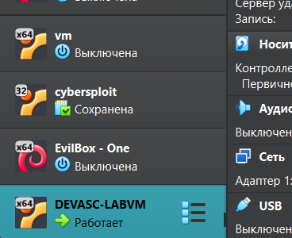

## Part 2 — GUI виртуальной машины

Запустил VM, принял лицензию Packet Tracer.

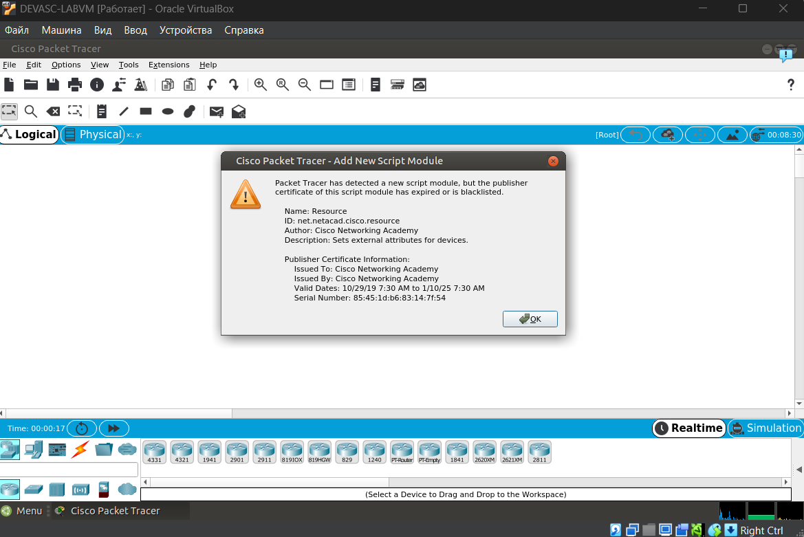

Рабочий стол VM:

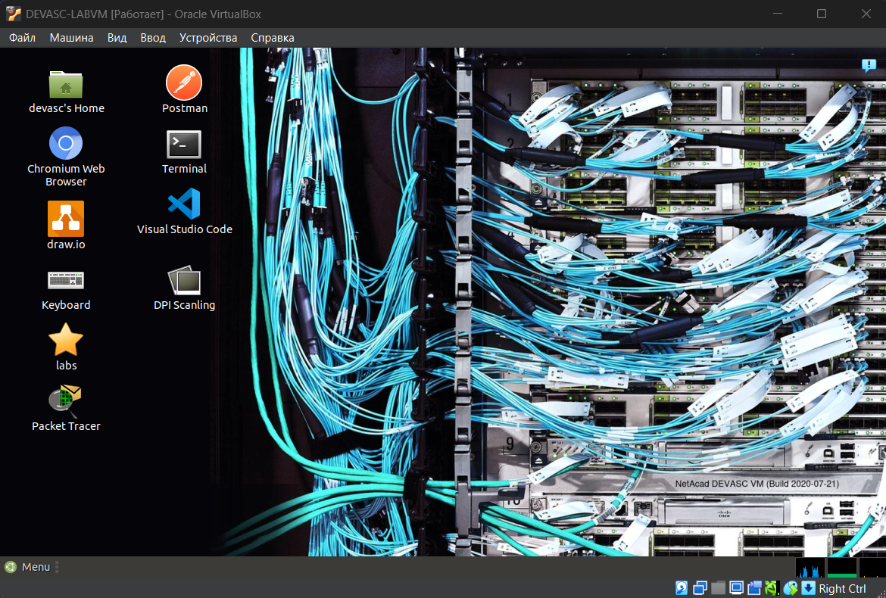

Открыл приложения: Terminal, VS Code, Postman, Chromium.

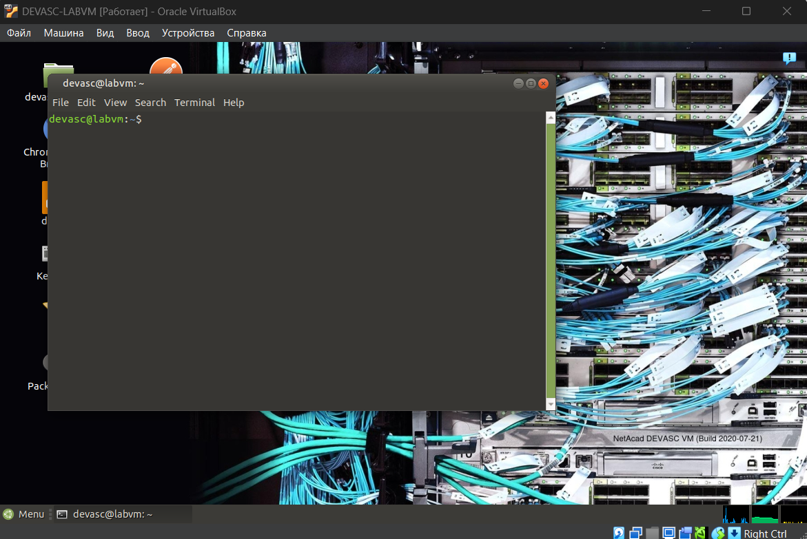
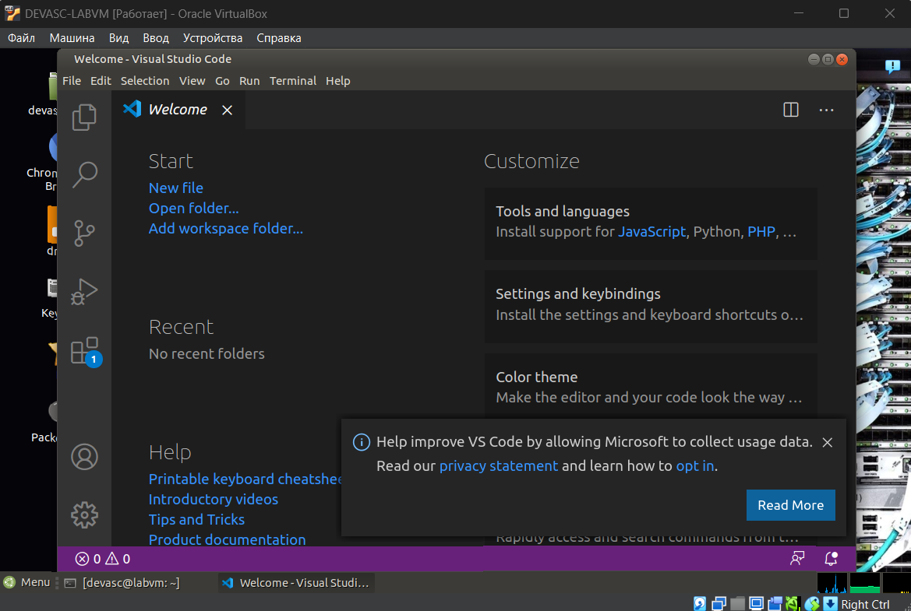
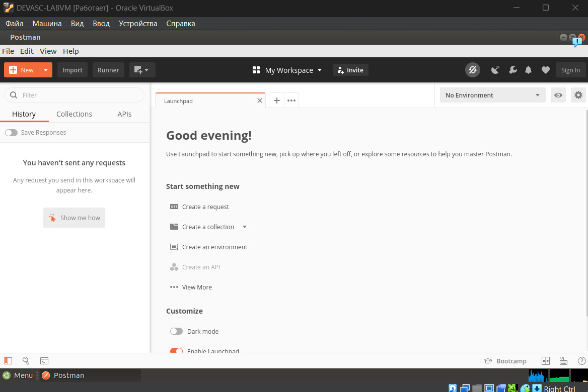
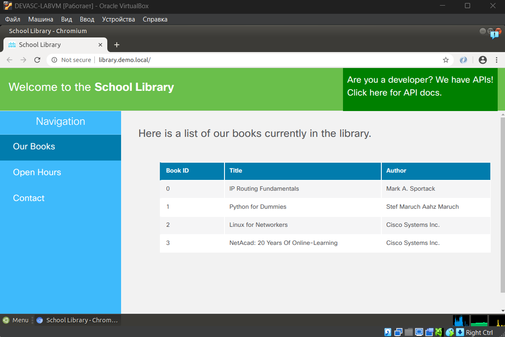

## Part 3 — Аккаунты

**DevNet** — https://developer.cisco.com

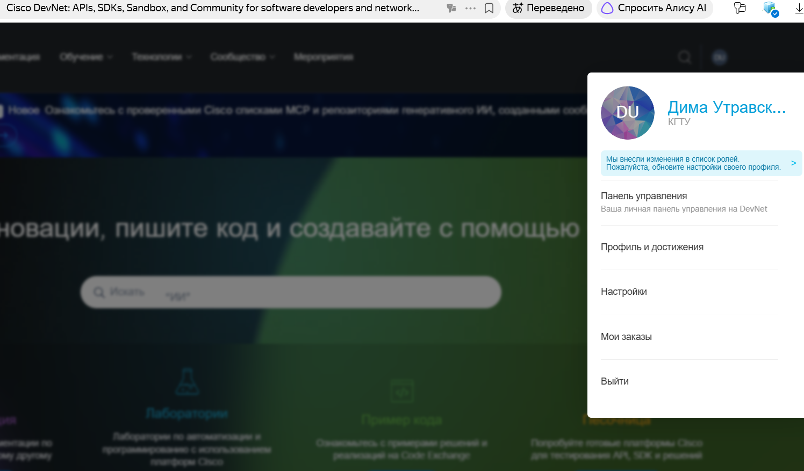

**GitHub** — https://github.com

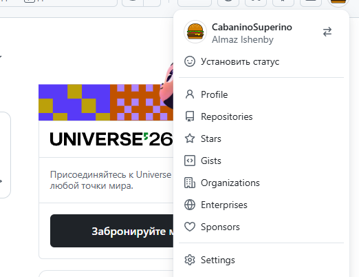

**Webex** — https://webex.com

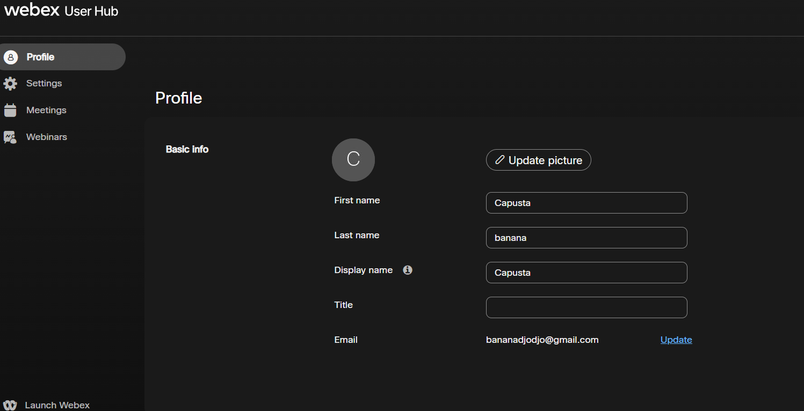

## Part 4 — Webex Teams

Установил Webex Teams, создал команду, отправил сообщение.

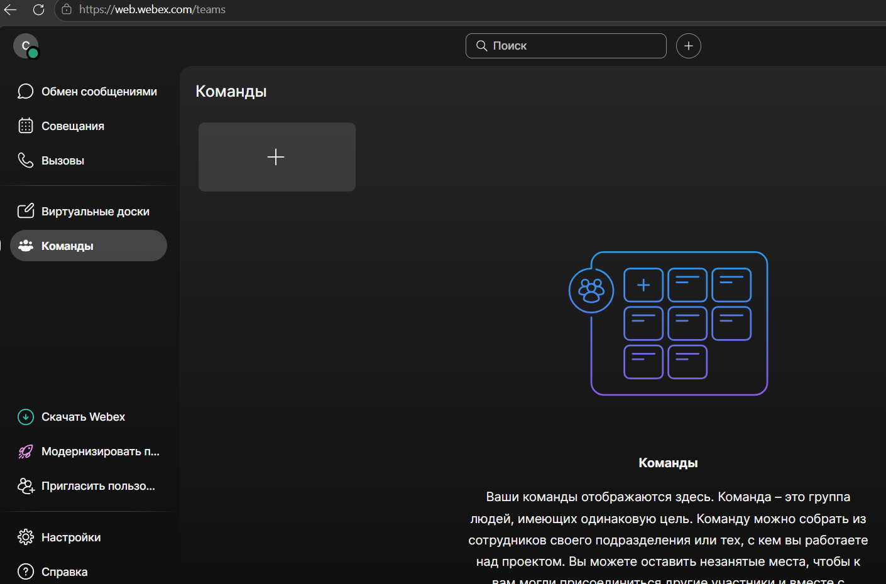
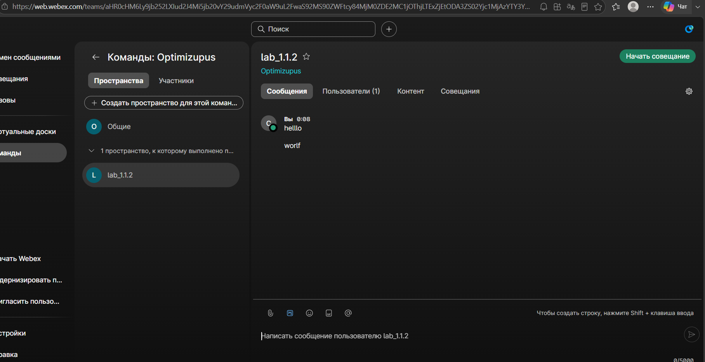

## Вывод

Развернул виртуальную машину DEVASC, познакомился с её инструментами, создал аккаунты для дальнейших лабораторных работ.

## Автор шедевра

Алмаз Ишенбаев, группа: БИС-1-23