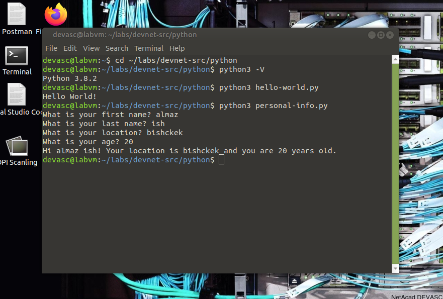
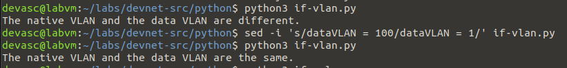
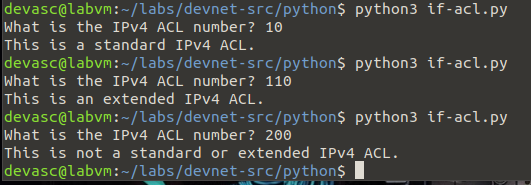
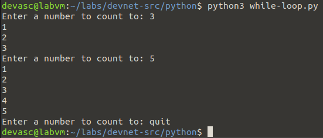
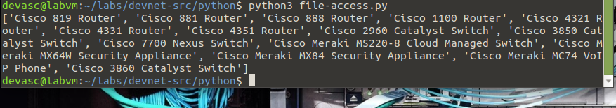

# 1.3.3 Lab — Python Programming Review

## Цель

Повторить базовый Python: типы данных, переменные, списки, словари, ввод, if/for/while, работа с файлами.

## Что сделал

### Part 2 — Python + Hello World + Input
Проверил версию Python в DEVASC VM, запустил `hello-world.py`, `personal-info.py`.

### Part 3, 4, 5 — Data Types, Lists, Dictionaries, Input
Разобрал int/float/str/bool, списки, словари, конкатенацию, приведение типов, `input()`.

### Part 6 — If / For / While
- `if-vlan.py` — два запуска: VLAN разные / одинаковые.
- `if-acl.py` — 10 (standard), 110 (extended), 200 (neither).
- `while-loop.py` — счёт до 3 и до 5, выход по `quit`.

### Part 7 — File Access
- `file-access.py` — читает `devices.txt` в список и выводит.

## Скрипты

Все скрипты лежат в папке [`scripts/`](scripts/):

- `hello-world.py`
- `personal-info.py`
- `if-vlan.py`
- `if-acl.py`
- `while-loop.py`
- `file-access.py`
- `file-access-input.py`
- `devices.txt`

## Вывод

Повторил базовый синтаксис Python, работу со списками, словарями, файлами и циклами в среде DEVASC VM.
