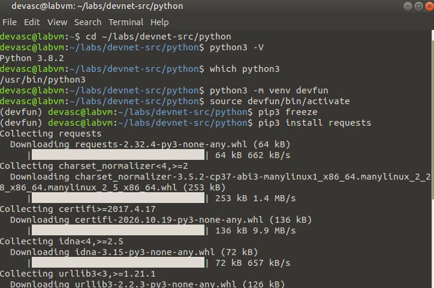
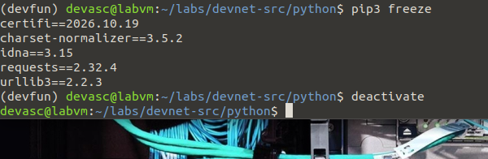
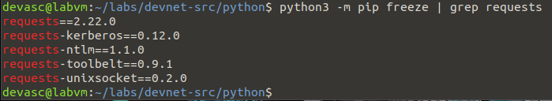
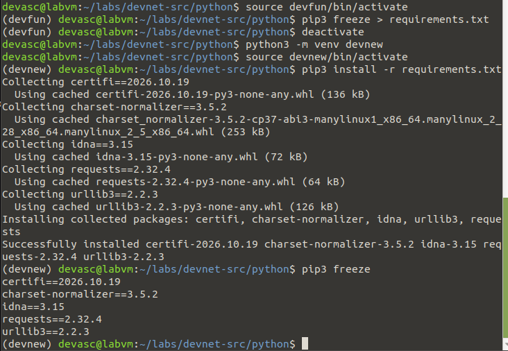

# 3.1.12 Lab — Explore Python Development Tools

## Цель
Изучить инструменты разработки Python: проверку установки, работу с менеджером пакетов PIP, создание виртуальных окружений (venv) и обмен ими через файл `requirements.txt`.

## Что сделал

### Part 2: Review the Python Installation
Проверил версию Python в DEVASC VM (Python 3.8.2) и путь к исполняемому файлу (`/usr/bin/python3`).

### Part 3: PIP and Python Virtual Environments
- Создал виртуальное окружение `devfun` с помощью `python3 -m venv devfun`.
- Активировал его и проверил, что оно пустое с помощью `pip3 freeze`.
- Установил пакет `requests` внутри окружения. Проверил изменения в списке пакетов (появились зависимости requests).
- Деактивировал окружение.
- Проверил установленные пакеты в системном окружении и нашел версию `requests` с помощью `python3 -m pip freeze | grep requests`.

### Part 4: Sharing Your Virtual Environment
- Активировал `devfun` и сохранил список зависимостей в файл `requirements.txt` с помощью `pip3 freeze > requirements.txt`.
- Создал новое окружение `devnew`.
- Активировал `devnew` и установил в него зависимости из файла `requirements.txt` с помощью `pip3 install -r requirements.txt`.
- Сделал `pip3 freeze` и убедился, что пакеты успешно установились и совпадают.

## Вывод
Научился изолировать зависимости проектов с помощью виртуальных окружений Python. Узнал, как переносить зависимости между окружениями с помощью `requirements.txt`, чтобы другие разработчики могли получить точно такое же окружение. Также настроен `.gitignore` для исключения папок окружений из репозитория.

