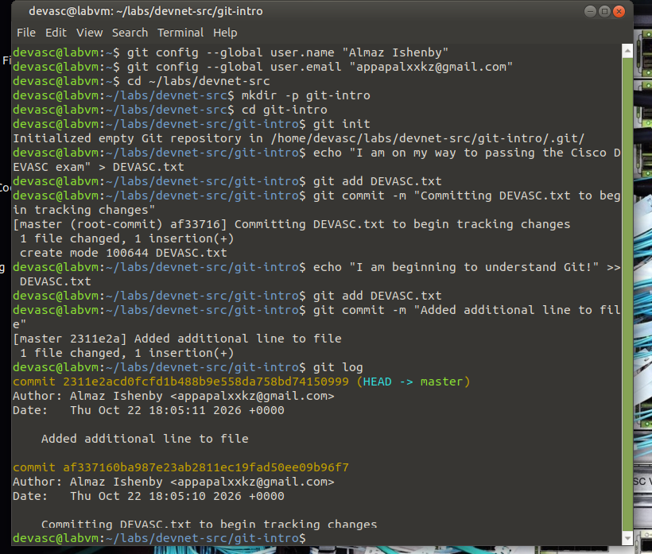
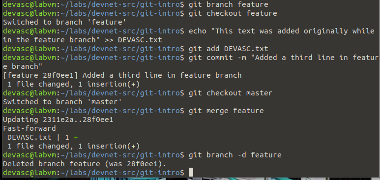
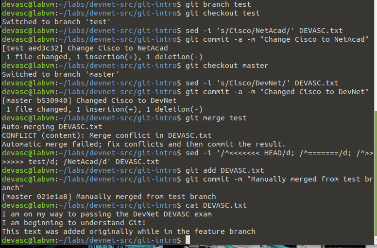
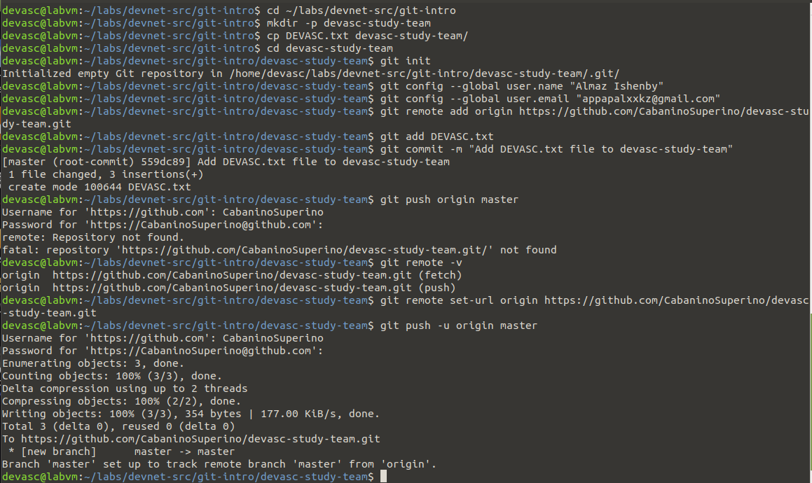
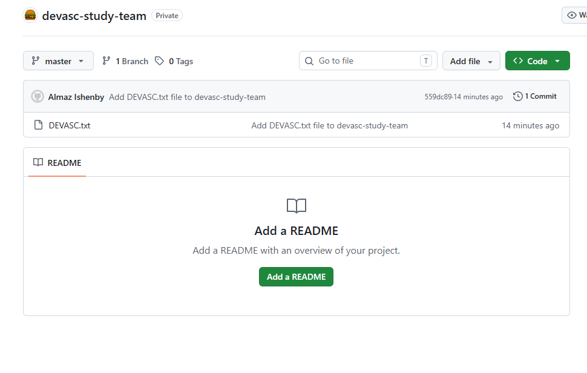

# 3.3.11 Lab — Software Version Control with Git

## Цель
Изучить основы работы с Git: инициализация репозитория, коммиты, ветвление, слияние и разрешение конфликтов, а также интеграция локального репозитория с GitHub.

## Выполнение

### Part 2, 3, 4: Initializing, Committing, and Modifying
Настроил глобальные переменные пользователя Git. Инициализировал локальный репозиторий `git-intro`.
Создал файл `DEVASC.txt`, добавил его в индекс (`git add`) и сделал первый коммит. 
Затем изменил файл, снова закоммитил и проверил историю коммитов с помощью `git log`.

### Part 5: Branches and Merging
Создал ветку `feature`, переключился на неё, добавил новую строку в файл и закоммитил изменения.
Переключился обратно на `master`, выполнил слияние (`git merge feature`) и удалил ветку `feature`.

### Part 6: Handling Merge Conflicts
Создал ветку `test`, изменил слово "Cisco" на "NetAcad" и закоммитил.
В ветке `master` изменил "Cisco" на "DevNet" и закоммитил.
При попытке слияния (`git merge test`) возник конфликт. Разрешил конфликт вручную (удалил маркеры слияния), затем закоммитил результат.

### Part 7: Integrating Git with GitHub
Создал приватный репозиторий `devasc-study-team` на GitHub.
Создал локальную папку, скопировал туда файл, инициализировал Git, настроил удаленный репозиторий (`git remote add origin`).
Закоммитил файл и отправил изменения на GitHub с помощью `git push origin master` (используя Personal Access Token).

## Вывод
Освоил базовые и продвинутые команды Git. Научился создавать ветки, сливать их, разрешать конфликты слияния и синхронизировать локальный репозиторий с облачным хранилищем GitHub.
