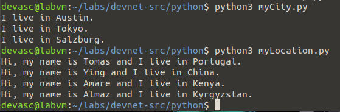
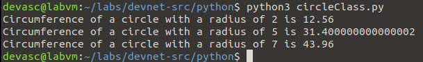

# 3.4.6 Lab — Explore Python Classes

## Цель
Изучить функции, методы и классы в Python. Создать класс, несколько раз его инстанцировать с разными значениями, а также разобрать пример класса Circle.

## Выполнение

### Part 3: Define a Function
Создал скрипт `myCity.py`, в котором определена функция `myCity(city)`, принимающая название города и выводящая строку. Вызвал функцию трижды с разными аргументами.

### Part 4: Define a Class with Methods
Создал скрипт `myLocation.py` с классом `Location`.
- Определил метод `__init__` для инициализации переменных `name` и `country`.
- Добавил метод `myLocation()`, который выводит приветствие с использованием этих переменных.
- Создал четыре экземпляра класса с разными именами и странами (включая свои данные).

### Part 5: Review the circleClass.py Script
Разобрал скрипт `circleClass.py`, содержащий класс `Circle`.
- Метод `__init__` принимает радиус.
- Метод `circumference()` вычисляет длину окружности по формуле (2 * pi * radius).
- Метод `printCircumference()` выводит результат, преобразуя числа в строки с помощью `str()`.
- Создал три экземпляра класса (с радиусами 2, 5 и 7) и вывел результаты.

## Вывод
Научился создавать функции и классы в Python, использовать конструктор `__init__` для инициализации атрибутов, а также вызывать методы у экземпляров классов.
