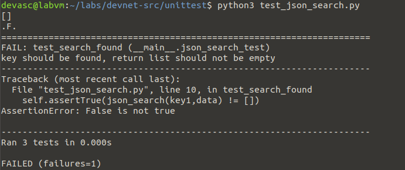
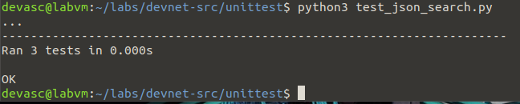

# 3.5.7 Lab — Create a Python Unit Test

## Цель
Изучить фреймворк `unittest` в Python. Написать unit-тесты для функции, выполняющей рекурсивный поиск по JSON-объекту.

## Выполнение

### Part 2: Explore Options in the unittest Framework
- Для создания индивидуального теста используется класс `unittest.TestCase`.
- Test runner определяет методы как тесты, если их названия начинаются с префикса `test_`.
- Для просмотра всех опций командной строки используется команда `python3 -m unittest -h`.

### Part 3: Test a Python Function with unittest
Созданы три файла:
- `test_data.py`: содержит JSON-данные и ключи для поиска.
- `recursive_json_search.py`: функция `json_search`, выполняющая поиск.
- `test_json_search.py`: класс `json_search_test`, содержащий три теста.

**Первый запуск (с ошибкой):**
Изначально переменная `ret_val = []` находилась внутри функции, из-за чего при рекурсивных вызовах список обнулялся. Тест `test_search_found` упал (появилась буква `F`).

**Исправление:**
1. Переменная `ret_val = []` была вынесена за пределы функции на уровень модуля.
2. Внутри функции добавлена команда `ret_val.clear()`, чтобы при каждом новом поиске список очищался (иначе данные от предыдущих тестов портили результаты следующих).
3. Удален вызов `print()` в конце скрипта, чтобы он не засорял вывод тестов.

**Второй запуск (успех):**
После исправления все 3 теста прошли успешно (выведено `OK`).

## Вывод
Научился писать автоматические unit-тесты с использованием библиотеки `unittest`. Понял важность изоляции состояния в рекурсивных функциях и убедился, как тесты помогают быстро находить и локализовать ошибки.