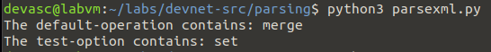
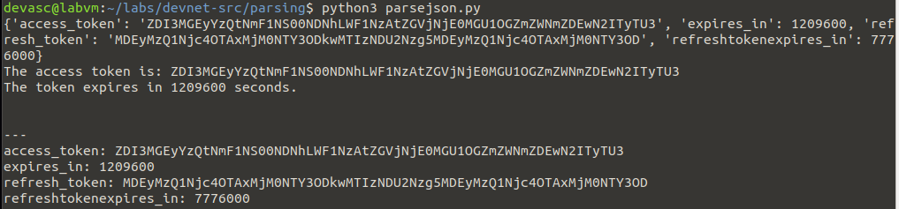
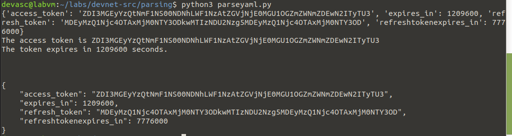

# 3.6.6 Lab — Parse Different Data Types with Python

## Цель
Научиться использовать Python для разбора (парсинга) различных форматов данных: XML, JSON и YAML.

## Выполнение

### Part 2: Parse XML in Python
Создан скрипт `parsexml.py`. С помощью модуля `xml.etree.ElementTree` и регулярных выражений был выполнен разбор файла `myfile.xml`. Скрипт извлекает значения тегов `<default-operation>` и `<test-option>`.

### Part 3: Parse JSON in Python
Создан скрипт `parsejson.py`. С помощью модуля `json` файл `myfile.json` загружается в словарь Python. Скрипт извлекает токен доступа (`access_token`) и время его жизни (`expires_in`). В конце данные конвертируются обратно в формат YAML с помощью модуля `yaml`.

### Part 4: Parse YAML in Python
Создан скрипт `parseyaml.py`. С помощью модуля `yaml` (метод `safe_load`) файл `myfile.yaml` загружается в словарь Python. Скрипт извлекает те же значения токенов. В конце данные конвертируются в формат JSON с отступами (используя `json.dumps(..., indent=4)`).

## Вывод
Научился работать с библиотеками Python для парсинга структурированных данных. Понял, как легко конвертировать данные между форматами XML, JSON и YAML, что крайне важно при работе с API и сетевыми конфигурациями.
